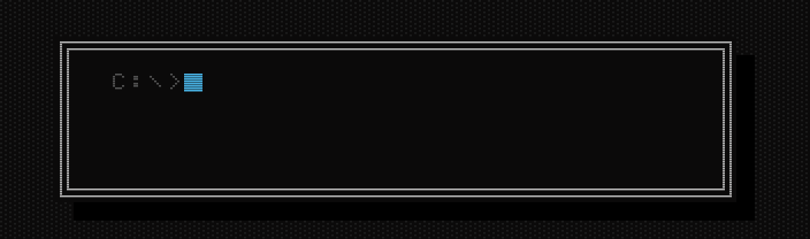
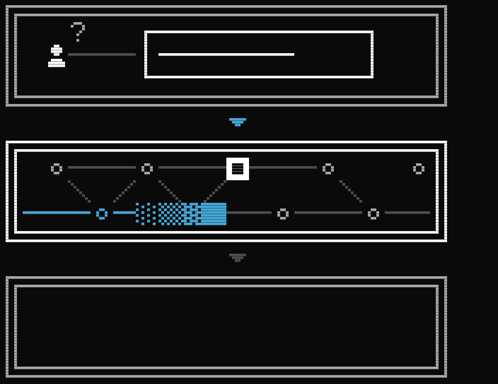
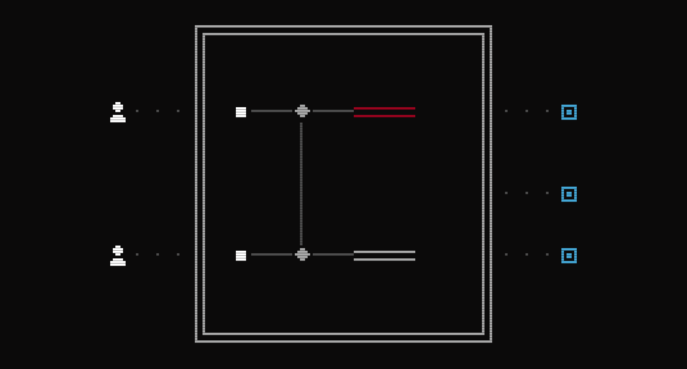
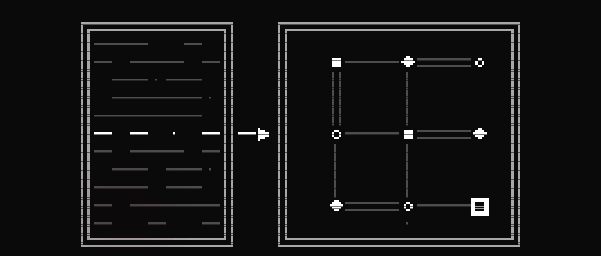
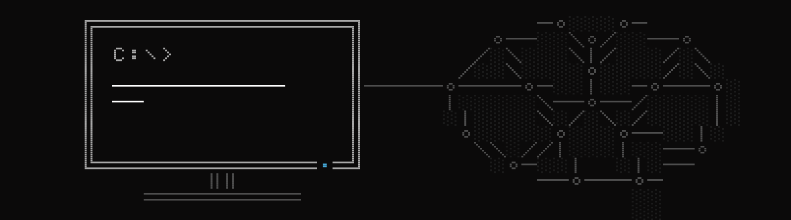

<p align="center">
   HACKATHON. AI BRAIN FOR INDUSTRY. 14.11.2026, Turin.">
</p>

# Hackathon · AI brain for industry

On 14 November you and your team build an AI brain for deep-tech industries.
Kakashi Venture Accelerator (KVA) runs the hackathon in Turin.

**[Apply now](https://www.kakashi.ventures/en/hackathon#signup)** . [Candidati ora](https://www.kakashi.ventures/it/hackathon#signup)

```
╔═ AT A GLANCE ══════════════════════════════════════════
║  DATE   Saturday 14 November 2026
║  TIMES  09:30 – 18:30
║  VENUE  Kakashi Venture Accelerator
║         Via Sant'Antonino 17B, 10139 Turin, Italy
║  PLACES 25 in Turin, 30 online
║  ENTRY  Free, no entry fee
║  PRIZE  €1,500 to the winning team
╚════════════════════════════════════════════════════════
```

## The challenge

### The AI brain for industry

Pick a real problem in applied AI and solve it on your own or in a team.
We are looking for creative, visionary people with an idea for how ontologies,
shared memory or custom-built AI brains could solve it.

<p align="center">
  
</p>

### Memory & AI

How does a memory tell when a rule has been superseded?
How do many agents write to the same memory without contradicting each other?
How do you record why a decision was made?

<p align="center">
  
</p>

### Custom ontologies for AI

An ontology is the basis on which a system draws inferences.
It is a formal specification of a shared conceptualisation.
It defines the classes, relations and axioms of a domain.

How do you build an ontology?
How do you update it when the company changes the way it works?
How does an agent use it to reason and not only to search?

<p align="center">
  
</p>

## Bring your project to life

<p align="center">
  
</p>

## You are a great fit for the hackathon if…

**You are a researcher.**
You can dig deep into complex problems.
You know what the scientific community is looking for in applied AI today.

**You are a deep-tech entrepreneur.**
You know how people will interact with technology in the near future.

**You have vertical expertise.**
You know one sector in depth.
You know which of its problems still need a solution.

**You are curious and creative.**
You have had an idea in mind for a while.
You are looking for a chance to build it.

There are 25 places in Turin and 30 places online.

## What we offer

- Free credits for the latest AI models
- Packed lunch
- Coffee
- Venture-building expertise

## Agenda

| Time | |
|---|---|
| 09:30 | Welcome and registration |
| 10:00 | Rules |
| 10:05 | Team matching |
| 10:15 | Talks: Venture Building, Memory and AI |
| 10:30 | Hacking, phase I: ideation |
| 12:30 | First show-off of the ideas |
| 13:00 | Lunch |
| 14:00 | Hacking, phase II: building |
| 16:30 | Financial validation |
| 17:00 | Final show-off and demo evaluation |
| 18:30 | Winner announcement |

## Frequently asked questions

**Do I need to know how to code?**
No. A team also needs people who do not code.

**What should I bring?**
Bring your laptop and charger.

**How do you choose participants?**
We read every application and look for teams with a mix of skills.

**Where are the rules?**
We publish them with the licences in this repository before the event.
Watch the repository to keep up with the rules and news.

**Who owns what I build?**
What you build belongs to you and your team.
For 12 months KVA has a right of first refusal if you sell it or license it exclusively, and can invest on the same terms if you raise money for a company built on it.
Licences and details are in the rules.

**I have another question.**
Write to us at [hello@kakashi.ventures](mailto:hello@kakashi.ventures).

## Apply

**[Apply now](https://www.kakashi.ventures/en/hackathon#signup)** . [Candidati ora](https://www.kakashi.ventures/it/hackathon#signup)

Applications close on Friday 13 November at 12:00 (CET).
It takes two minutes. You will hear from us within three working days.
